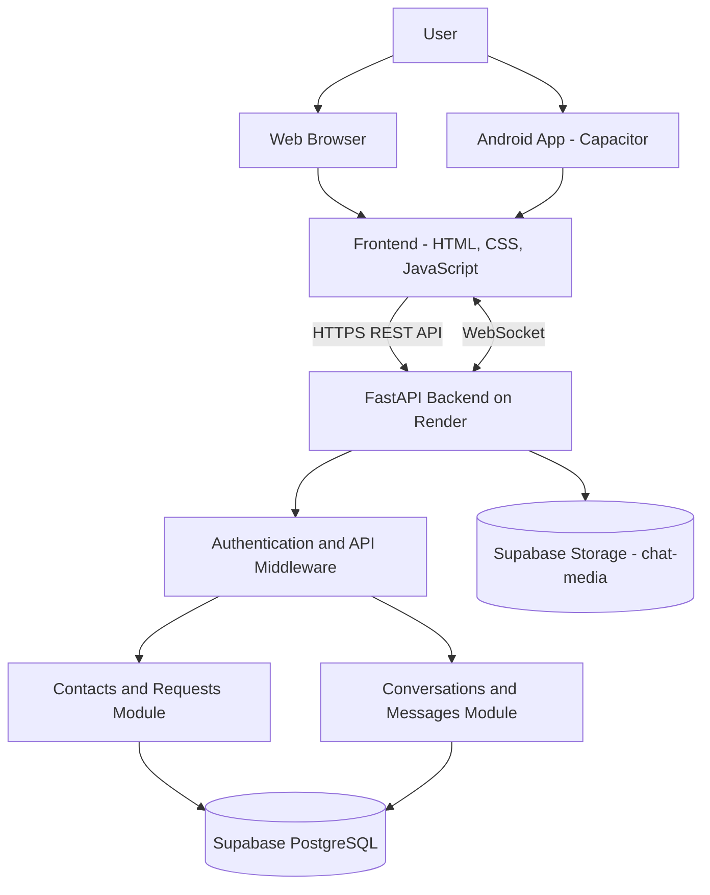
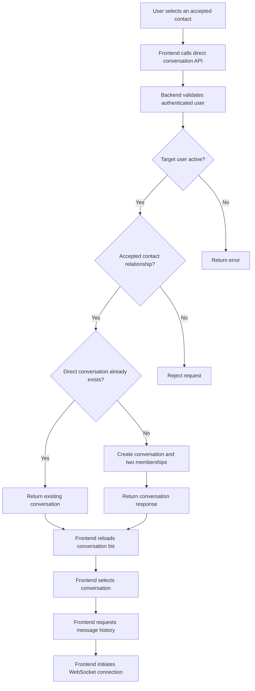
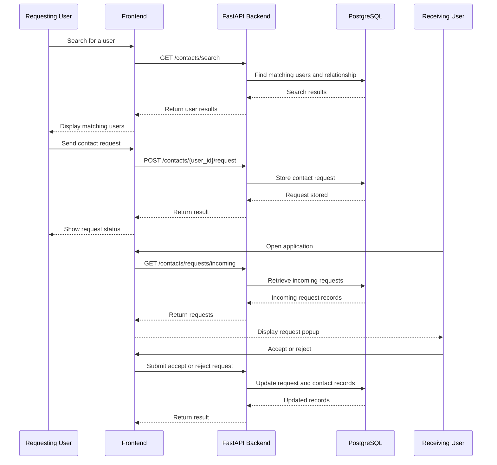
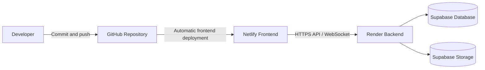

Sha'sapp --- System Architecture
Project: Sha'sapp
Document Type: Architecture Documentation
Architecture Style: Client--Server Architecture
Status: Development in Progress
- Frontend: https://sha-sapp.netlify.app/
- Backend API: https://sha-sapp.onrender.com
- GitHub Repository:
  https://github.com/jhaabhay7667-cyber/Sha-sApp
1. Architecture Overview
Sha'sapp is structured as a client--server messaging application. The
frontend provides the user interface and communicates with the backend
through HTTP API requests and a WebSocket connection for
conversation-related communication.

The backend is built with Python and FastAPI. It handles authentication,
contact management, conversation operations, and message-related
requests. PostgreSQL stores application records, while Supabase Storage
is configured for chat media.

The frontend and backend are deployed separately: - Netlify hosts the
frontend. - Render hosts the backend API. - Supabase provides production
PostgreSQL infrastructure and media storage. - GitHub stores and manages
the source code. - Capacitor is configured as the Android packaging
layer.
2. High-Level Architecture

The diagram represents the documented logical architecture. Actual
runtime routing and deployment details should be checked against the
current configuration.
3. Architecture Layers
3.1 Presentation Layer
Technologies: HTML5, CSS3, JavaScript

Responsibilities: - Display registration and login screens. - Display
the authenticated application. - Provide Find People search. - Display
contact and request status. - Provide Accept and Decline request
actions. - Display contacts and conversations. - Open a selected direct
conversation. - Display message history and messaging controls. - Make
API requests to the backend. - Initiate a WebSocket connection for a
selected conversation.

The deployed frontend files are located in the project's web output
directory:
frontend/
└── www/
    ├── index.html
    ├── css/
    │   └── style.css
    └── js/
        └── app.js
3.2 API and Application Layer
Technologies: Python, FastAPI, SQLAlchemy

The backend provides the application's API and business logic.

Responsibilities: - Process authentication requests. - Validate
authenticated API requests. - Search registered users. - Create and
manage contact requests. - Accept or reject contact requests. - Retrieve
accepted contacts. - Create or retrieve direct conversations. - Retrieve
conversation lists. - Retrieve message history. - Handle message-sending
requests. - Interact with database and storage services.

The frontend uses the deployed API base URL:
https://sha-sapp.onrender.com
3.3 Data Layer
Database: PostgreSQL, using Supabase production infrastructure.

The database stores structured application records, including: - User
accounts. - Conversations. - Conversation membership. - Contact
requests. - Accepted contacts. - Messages. - Message read records. -
Message delivery records. - Call-session records.
3.4 Media Storage Layer
Provider: Supabase Storage
Bucket: chat-media

The backend storage module is configured to use Supabase credentials
supplied through backend environment variables. The bucket is private.
The service-role key must remain on the backend and must not be placed
in frontend JavaScript or committed to source control.
4. Frontend Architecture
The frontend is responsible for user interaction and presentation.
Main frontend responsibilities
  Component / Feature                 Responsibility
  Authentication screens              Registration and login interface

  API request helper                  Sends requests to the backend and
includes the session bearer token

  Find People                         Searches users by name or email

  Contact request UI                  Sends and displays contact requests

  Request modal                       Displays incoming requests and
provides response actions

  Contacts                            Displays accepted contacts

  Conversation list                   Displays available conversations

  Direct chat action                  Requests and opens a direct
conversation

  Message history                     Retrieves and displays conversation
messages
WebSocket client                    Initiates a connection for the
selected conversation
Authentication state
The frontend uses the authentication token stored in browser session
storage for authenticated API requests. The application switches between
authentication and authenticated views based on the current login state.
API communication
The frontend sends HTTPS requests to the Render backend. The API request
helper attaches the bearer token where required.
WebSocket communication
When a conversation is selected, the frontend invokes its WebSocket
connection functionality for that conversation. Real-time delivery,
reconnection, and background behavior require end-to-end verification.
5. Backend Architecture
The backend uses FastAPI to expose API routes and process application
operations.

The known backend responsibilities are organized around these logical
areas:
5.1 Authentication
- Authenticate users.
- Provide authentication information to the frontend.
- Protect endpoints that require a logged-in user.
5.2 Contacts
- Search users.
- Send contact requests.
- Retrieve incoming requests.
- Retrieve outgoing requests.
- Accept requests.
- Reject requests.
- Retrieve accepted contacts.
5.3 Messages and Conversations
- Retrieve the current user's conversations.
- Create or retrieve direct conversations.
- Retrieve conversation message history.
- Accept message-sending requests.
- Build conversation responses for the frontend.
5.4 Storage Integration
- Connect to Supabase Storage.
- Use backend environment configuration.
- Manage files in the configured chat-media bucket.
The exact Python package and module boundaries should be confirmed from
the current backend source tree; this document describes the known
logical responsibilities rather than assuming unverified filenames.
6. API Architecture
The frontend and backend communicate through REST API endpoints.
6.1 Contacts API
  Method                  Endpoint                                   Purpose
  GET                     /contacts/search?q={search_term}         Search users by name or
email

  POST                    /contacts/{user_id}/request              Send a contact request

  GET                     /contacts/requests/incoming              Retrieve incoming
requests

  GET                     /contacts/requests/outgoing              Retrieve outgoing
requests

  POST                    /contacts/requests/{request_id}/accept   Accept a request

  POST                    /contacts/requests/{request_id}/reject   Reject a request
GET                     /contacts/                               Retrieve accepted
contacts
6.2 Messages API
  Method                  Endpoint                                               Purpose
  POST                    /messages/conversations/direct/{contact_user_id}     Create or retrieve a
direct conversation

  GET                     /messages/conversations                              Retrieve the user's
conversations

  GET                     /messages/conversations/{conversation_id}/messages   Retrieve conversation
history
POST                    /messages/conversations/{conversation_id}/messages   Send a message
These endpoints are based on the routes shared during development.
Request and response schemas should be checked against the current
backend code when implementing additional clients.
7. Direct Conversation Creation Flow
The direct conversation endpoint is designed to return an existing
conversation when one already exists between the two users.

The backend checks that the user is not opening a conversation with
themselves, that the target account is active, and that the users have
an accepted contact relationship.
8. Contact Request Flow

The current frontend checks incoming requests every 10 seconds while the
authenticated application is open. This is polling, not a
push-notification service.
9. Message Communication Flow
The documented frontend behavior is:
1. A user selects a conversation.
2. The frontend sets the active conversation ID.
3. The frontend requests the conversation's message history.
4. The frontend initiates the WebSocket connection for that
   conversation.
5. The user can use the message interface to submit messages through
   the message API.
The exact WebSocket event protocol, message acknowledgement behavior,
retry policy, and delivery guarantees are not established by the
information currently documented. They must be verified from the backend
and frontend implementation.
10. Database Architecture
The production database was previously verified to contain these nine
tables:

  Table                    Responsibility
  users                  Stores user account records
conversations          Stores conversation records
conversation_members   Associates users with conversations
contact_requests       Stores contact request records
contacts               Stores accepted contact relationships
messages               Stores messages
message_reads          Stores message read records
message_deliveries     Stores message delivery records
call_sessions          Stores call-session records
Known logical relationships
- A user can create or participate in conversations.
- Conversation membership associates users with conversations.
- Contact requests represent connection requests between users.
- Accepted contact records represent established relationships.
- Messages belong to conversations.
- Message read and delivery records track message-related status.
The exact foreign keys, indexes, uniqueness constraints, and
cardinalities should be verified against the current database schema
before making schema-level changes.
11. Deployment Architecture
  Layer                   Service                 Responsibility
  Source control          GitHub                  Stores project source
code and version
history

  Frontend hosting        Netlify                 Serves the deployed web
frontend

  Backend hosting         Render                  Runs the FastAPI
backend

  Database                Supabase PostgreSQL     Stores application
records

  Media storage           Supabase Storage        Stores chat media
Android packaging       Capacitor               Packages the web
application for Android
Deployment flow

The current website deployment is connected to the GitHub repository.
After a successful push, Netlify can deploy the updated frontend
automatically.
12. Security Architecture
Known security practices include:
- Authentication for protected backend endpoints.
- Bearer-token authentication for frontend API requests.
- Private backend environment variables for sensitive configuration.
- Keeping the Supabase service-role key out of frontend code.
- Performing database operations through the backend.
- Using a private Supabase Storage bucket for chat media.
Further security review should verify token expiration and refresh,
authorization on every conversation and message endpoint, input
validation, rate limiting, CORS policy, upload restrictions, and storage
access controls.
13. Reliability and Error Handling
The architecture depends on multiple external services. The application
should account for:
- Backend unavailability.
- Database connection failures.
- Expired or invalid authentication tokens.
- Failed contact-request operations.
- Conversation creation failures.
- Message-history loading failures.
- WebSocket disconnections.
- Storage upload and retrieval failures.
The frontend should display clear error messages and avoid leaving
controls in a permanently disabled or loading state.
14. Current Architecture Limitations
The following limitations are important when describing the current
system:
1. Incoming contact requests are checked through periodic polling while
   the app is open.
2. Polling does not provide notifications when the app is closed.
3. WebSocket initiation exists in the frontend, but end-to-end
   real-time behavior requires testing.
4. Push notifications are not confirmed as implemented.
5. Voice/video calling and complete group-chat workflows are not
   confirmed as implemented.
6. The complete media upload and display workflow requires end-to-end
   verification.
7. Capacitor configuration does not by itself prove that a
   production-ready Android build has been tested.
15. Future Architecture Improvements
Potential improvements include:
- A push-notification service for background notifications.
- More robust WebSocket reconnection and connection-state handling.
- Message delivery and read-status updates.
- Dedicated group conversation workflows.
- Secure media upload and retrieval flows.
- Voice and video communication services.
- Better observability through structured logs and error monitoring.
- API rate limiting and abuse prevention.
- Automated unit, integration, and end-to-end tests.
These are proposed improvements, not claims about existing
functionality.
16. Summary
Sha'sapp uses a layered client-server architecture:
- The frontend handles the user interface and client-side interaction.
- FastAPI provides authenticated application APIs and business logic.
- PostgreSQL stores structured application data.
- Supabase Storage stores chat media.
- Netlify and Render host the frontend and backend separately.
- GitHub manages source code.
- Capacitor provides the Android packaging path.
This architecture separates presentation, application logic, persistent
data, media storage, and deployment responsibilities. It provides a
foundation for maintaining the existing messaging workflows and adding
future capabilities.